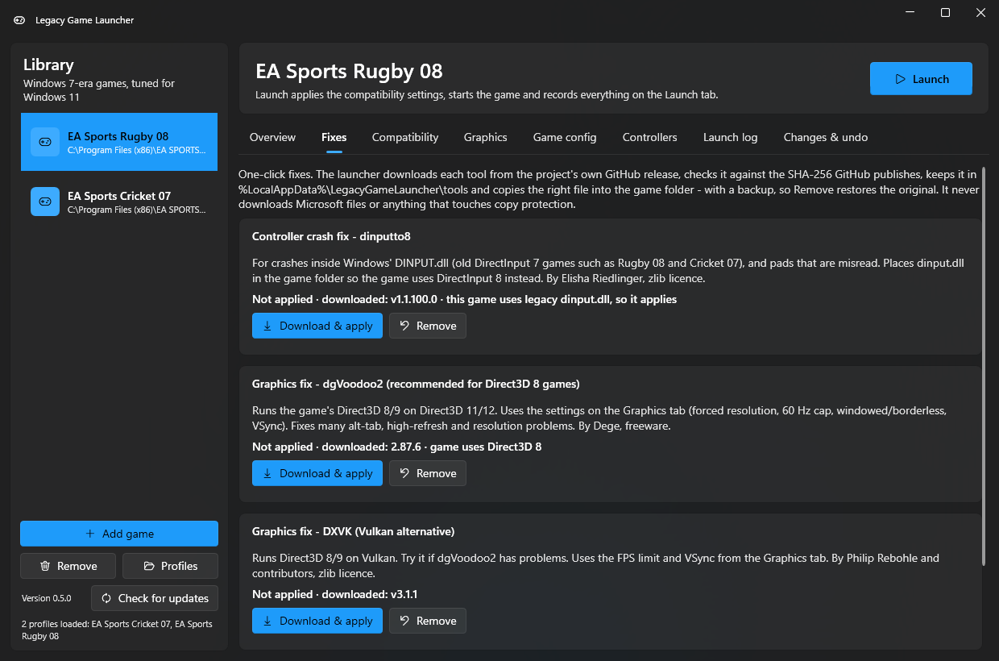
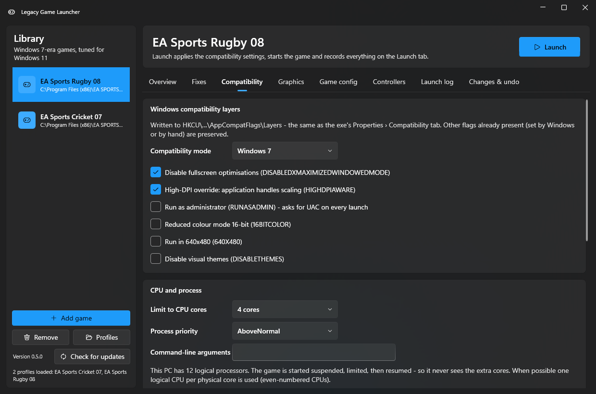
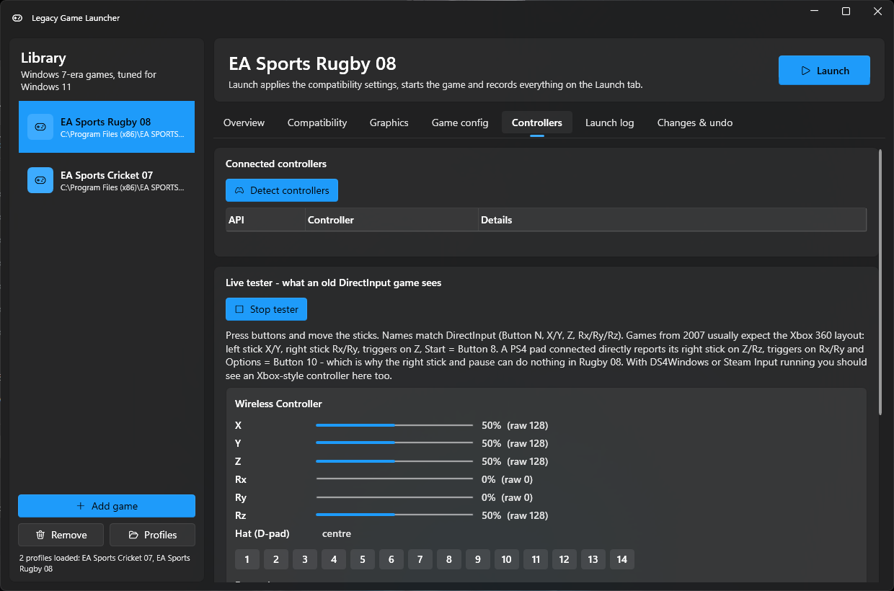

<div align="center">


# Legacy Game Launcher

**Get Windows 7-era 32-bit DirectX games running properly on Windows 11.**

Built for **EA Sports Cricket 07** and **EA Sports Rugby 08** - and any other old Direct3D 8/9 game you add.

[](https://github.com/bothamad/legacy-game-launcher/releases/latest)
[](https://github.com/bothamad/legacy-game-launcher/releases)


[](https://ko-fi.com/drquashi)



</div>

---

## Why this exists

Games from 2006-2008 were written for Windows XP and Vista. On Windows 11 they tend to crash at start-up,
misread modern controllers, run at the wrong resolution, flicker on high-refresh monitors or fall over when you
alt-tab. The fixes are known - compatibility flags, a graphics wrapper, a DirectInput wrapper, the right config
tweak - but they're scattered across old forum threads and easy to get wrong.

Legacy Game Launcher puts them in one place: it **inspects the game**, tells you what's wrong, applies the fixes
**with a backup**, launches the game, and **reads the crash report** if it still fails. Everything it changes
can be undone with one click.

## Games it's built for

| | **EA Sports Cricket 07** | **EA Sports Rugby 08** |
|---|---|---|
| Developer / year | HB Studios / EA Canada, 2006 | HB Studios, 2007 |
| Executable | `Cricket07.exe` | `Rugby08.exe` |
| Graphics | Direct3D 8 | Direct3D 8 |
| Controller input | Legacy DirectInput 7 (`dinput.dll`) | Legacy DirectInput 7 (`dinput.dll`) |
| Settings file | Binary profile `Documents\EA SPORTS(TM) Cricket 07\*.pro` | Binary profile `Documents\EA SPORTS(TM) Rugby 08\*.pro` |
| Retail copy protection | SafeDisc 4 | SafeDisc |

Both share the same engine and the same Windows 11 problems, so the built-in profiles for them come with
researched settings and notes (sources in [GAME_NOTES.md](GAME_NOTES.md)).

**Other games:** add any 32-bit (or 64-bit) Windows game's `.exe`. The launcher detects its Direct3D version,
input API, runtimes and copy protection from the exe itself and offers the same tools. You can add your own
profile for a game - see [Adding games](#adding-games).

## Common problems and what to do

| Problem | Cause | Fix in the launcher |
|---|---|---|
| Crash a few seconds after start, crash report names **`DINPUT.dll`** | Old DirectInput 7 code trips over modern controllers / HID devices | **Fixes → dinputto8 → Download & apply** |
| **Rugby 08 / Cricket 07 with a PS4 pad** | These games expect a DirectInput pad (Logitech Rumblepad 2 layout) - a PS4 pad over USB already matches it | Plug the pad in directly and **don't use DS4Windows** (its HidHide/USBip drivers made Rugby 08 crash in `DINPUT.dll`). Pause is **Esc**; special moves are **L1 + face button** |
| **PS4 / PS5 pad** in other games: pause does nothing, **right stick** doesn't work | DirectInput sees the PlayStation layout (right stick on Z/Rz, Options = button 10); these games expect the Xbox 360 layout | Run [DS4Windows](https://github.com/Ryochan7/DS4Windows) (Xbox 360 emulation) and hide the real pad with HidHide; check with **Controllers → Live tester** |
| With DS4Windows, face buttons are mixed up (e.g. the game's **X** action is on **Circle**) | The game expects PlayStation-style button numbers, DS4Windows sends Xbox ones | **Controllers → Button layout → PlayStation-direct → Apply** (per-game DS4Windows profile, switched automatically) |
| Flicker, wrong speed or odd behaviour on a **120-165 Hz** monitor | Game picks the monitor's highest refresh rate | **Fixes → dgVoodoo2** (60 Hz cap + forced resolution on the Graphics tab) |
| Stuck at 1024×768 / wrong resolution | Resolution is stored in the binary `.pro` profile | **Game config → Scan**, then set the resolution (backed up first) |
| Want widescreen or a community mod | Needs extra files in the game folder | **Fixes → Your own files → Add a folder…** (backed up, one-click undo) |
| Crash on alt-tab, or you want windowed / borderless | Exclusive full-screen Direct3D 8 | **Fixes → dgVoodoo2**, tick *Windowed* / *Borderless* on the Graphics tab |
| Missing `d3dx9_xx.dll` / `xinput1_3.dll` etc. | June 2010 DirectX runtime not installed | **Overview → Legacy runtime dependencies** links to Microsoft's installer |
| "Please insert the correct disc", or the game exits silently | Copy protection - SafeDisc's driver is disabled on Windows 10/11 | Shown on **Overview → Copy protection**. The launcher explains it but **never bypasses it** |

## Quick start

1. **Download** `LegacyGameLauncher.exe` from the [latest release](https://github.com/bothamad/legacy-game-launcher/releases/latest).
   No installer, no .NET needed - just run it. (Windows SmartScreen may warn about a new app: *More info → Run anyway*.)
2. **Add game** → select the game's `.exe` (e.g. `C:\Program Files (x86)\EA SPORTS\EA SPORTS(TM) Rugby 08\Rugby08.exe`).
3. Check the **Overview** tab - it lists what the game uses and anything missing.
4. On **Compatibility**, press **Load recommended**, then **Save & apply**.
5. Press **▶ Launch**. If the game fails, the **Launch log** shows the crash report and a suggestion - usually a
   one-click entry on the **Fixes** tab.

## Features

<table>
<tr><td width="50%">

**🩹 One-click fixes**
dinputto8, dgVoodoo2 and DXVK, downloaded from each project's official GitHub release, verified against GitHub's
SHA-256, installed with backup - and removable. **Your own files**: add a mod or fix you downloaded (files or a
whole folder) - backed up, listed and undoable.

**🛠️ Compatibility**
Windows compatibility modes and flags, CPU core limit and priority applied *before* the game's code runs,
launch arguments, disc-image (.iso) mounting.

**🖥️ Graphics**
dgVoodoo2 / DXVK with the right `d3d8.dll` / `d3d9.dll` for the game: forced resolution, refresh-rate cap,
windowed/borderless, VSync, FPS limit.

**📝 Game config**
Finds config files and registry values instead of guessing, quick-sets resolution, edits the binary `.pro`
resolution of HB Studios' EA games.

</td><td width="50%">

**🎮 Controllers**
Shows which input API the game expects and a **live tester** that displays buttons and axes exactly as an old
DirectInput game sees them - with PlayStation and Xbox button names. **Per-game button layout** for DS4Windows,
switched automatically while the game runs.

**🔍 Diagnostics**
Follows child processes, decodes exit codes, pulls the Windows Error Reporting entries and gives advice based on
the module that crashed. *Copy diagnostics* for asking for help.

**↩️ Undo everything**
Every file and registry change is journaled with the original state. Undo one group or everything.

**🔄 Self-updating**
Checks this repository for new releases and updates itself (SHA-256 verified) - your games and settings stay.

</td></tr>
</table>

## Screenshots

| Compatibility | Live controller tester |
|---|---|
|  |  |

## Safe by design

- **No copy-protection workarounds.** SafeDisc / SecuROM / StarForce are detected and explained, never patched,
  removed or bypassed. If a SafeDisc loader you installed yourself is present, the launcher only avoids breaking it.
- **No admin rights** for the launcher. When an action needs them (e.g. writing into `Program Files`) it asks for
  that one action, through a short-lived copy of itself that runs only the request fixed before the UAC prompt.
- **No Microsoft DLLs** are bundled or downloaded - it links to Microsoft's own installers.
- **Verified downloads** - fixes and updates come only from the projects' own GitHub releases and are checked
  against GitHub's SHA-256 before use.
- **No telemetry.** The only network calls are to `api.github.com` / `github.com` for update checks and fixes you
  choose to download.

## Updating

The launcher checks for a new release a moment after it starts. When one is available a banner appears in the
sidebar - press **Update now**. You can also press **Check for updates** at any time. What changed in each
version is in the release notes and in [CHANGELOG.md](CHANGELOG.md).

## Build from source

Requires the .NET 8 SDK on Windows.

```powershell
dotnet publish LegacyGameLauncher -c Release -o publish
```

Output: `publish\LegacyGameLauncher.exe` (single file, self-contained, about 65 MB).

## Where things are kept

`%LocalAppData%\LegacyGameLauncher\`

| Folder / file | Contents |
|---|---|
| `library.json` | Your games and their settings |
| `backups\` | Originals of every file the launcher replaced |
| `tools\` | Downloaded fixes (with source and SHA-256) |
| `profiles\` | Your own game profiles (+ `example-*.json.txt`) |
| `logs\` | A report for every launch |

## Adding games

Put a `*.json` profile in `%LocalAppData%\LegacyGameLauncher\profiles\` (the built-in profiles are exported
there as `example-*.json.txt` to copy). A profile with the same `Id` as a built-in one replaces it. Add your exe's
SHA-256 (shown on the Overview tab) for an exact match. Pull requests with profiles for more games are welcome.

## Support the project

Legacy Game Launcher is free. If it got your old games running again and you'd like to say thanks,
you can buy me a coffee on Ko-fi:

<a href="https://ko-fi.com/drquashi"></a>

## Credits

- **[u/Theuchiha_](https://www.reddit.com/user/Theuchiha_/)** on Reddit - for the community help that got
  **Cricket 07** and **Rugby 08** running on Windows 11. Thank you!
- [dinputto8](https://github.com/elishacloud/dinputto8) by Elisha Riedlinger (zlib)
- [dgVoodoo2](https://github.com/dege-diosg/dgVoodoo2) by Dege (freeware)
- [DXVK](https://github.com/doitsujin/dxvk) by Philip Rebohle and contributors (zlib)
- [WPF-UI](https://github.com/lepoco/wpfui) by lepo.co (MIT) - the Fluent interface
- [DS4Windows](https://github.com/Ryochan7/DS4Windows) and HidHide - recommended for PlayStation controllers
- The Cricket 07 and Rugby 08 communities on PCGamingWiki, Planet Cricket and The Rugby Forum, whose research is
  collected in [GAME_NOTES.md](GAME_NOTES.md)

---

<sub>Not affiliated with or endorsed by Electronic Arts or HB Studios. EA SPORTS, Cricket 07 and Rugby 08 are
trademarks of their respective owners. You need your own legitimate copy of each game.</sub>
